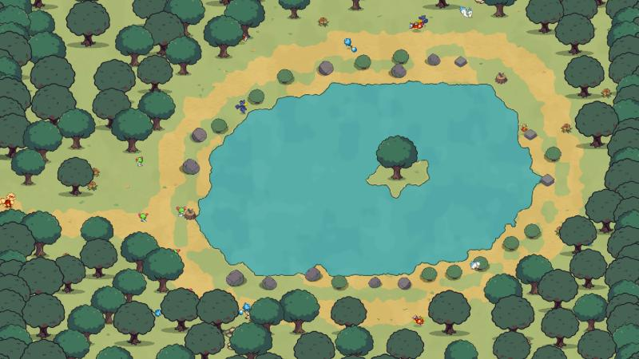

# Pokémon Valley · el mundo (zonas)

Plan del 2026-10-15: pasar de dos mapas sueltos a un mundo por zonas, como Azeroth pero en pequeño. La primera
versión tiene **3 zonas**. El combate, la captura y los niveles están en [GDD-combate.md](GDD-combate.md).

Código: [src/data/bosque.ts](../src/data/bosque.ts) (zonas: `crearMapa`, alfas, tablón), [src/scenes/Aventura.ts](../src/scenes/Aventura.ts)
(cambio de zona, colisión con el agua) y [src/scenes/HudAventura.ts](../src/scenes/HudAventura.ts) (rótulo de zona).
Misiones y alfas: §2.

## 1. Zonas de la v1

```
  Lago Celeste (nv 5-10) ◄── este ── Bosque Verde (nv 1-7) ◄── camino del sur ── Pueblo
```

| Zona | Nivel | Qué hay | Especies | Estado |
|---|---|---|---|---|
| **Pueblo** | — | Tu hogar, por zonas (§1b). Tus Pokémon pasean por la plaza; con F te conviertes en ellos. | — | Hecho |
| **Bosque Verde** | 1-7 | Claros unidos por senderos y borde espeso de árboles. Al fondo, un sendero sale por el este al lago. | 7 de `ESPECIES_BOSQUE` (Bicho, Planta, Volador…) | Hecho |
| **Lago Celeste** | 5-10 | Lago con islote, playas a trozos, un camino que lo rodea, rocas y arbustos en la orilla. | 7 de `ESPECIES_LAGO` (Psyduck, Marill, Magikarp, Pachirisu…) | Hecho con arte provisional |



- **Mundo fijo.** Cada zona procedural sale siempre igual con la semilla de la partida (`estado.semilla`). Antes el
  bosque cambiaba cada vez que entrabas.
- **Rótulo al entrar** (como en el WoW): el nombre de la zona en grande y, debajo, nivel y tipos. Arriba a la derecha
  sigue el nombre de la zona con la hora.
- **El agua es del suelo** (vértices 3 de `Terrain`): bloquea el paso (`Terrain.esAgua`) y no lleva la pared de roca
  pixel art (`Paleta.sinPared` en la paleta dibujo).
- **Cambio de zona**: andando hasta el borde, con un fundido. El suelo tarda 1-2 s en calcularse (consola: "Suelo
  listo en X ms").

### 1b. El pueblo, por zonas (2026-10-15)
Código: [src/data/puebloAventura.ts](../src/data/puebloAventura.ts). Solo es el pueblo del modo aventura; el del modo
granja sigue en `mapaDibujo.ts`. Capturas: [de día](img/pueblo_v2_dia.jpg), [de noche](img/pueblo_v2_noche.jpg) y
[el huerto](img/pueblo_v2_huerto.jpg).

- **Plaza central** (losas): la hoguera en medio, el tablón de misiones al oeste, el pozo al este y farolas alrededor.
  Apareces al sur de la hoguera.
- **Avenida** (losas): de la boca sur del pueblo (salida al bosque, con su poste) a la plaza.
- **Calle del norte** (tierra): las casas en fila con la puerta a la calle. De oeste a este: la cabaña, **tu casa**
  (sobre la plaza) y la casa larga.
- **Oeste:**
  - la casa de la chimenea;
  - el **huerto**: 6 parcelas, cada una un corral de valla, sobre una mancha de tierra orgánica. Es el sitio para
    sembrar bayas cuando el modo aventura las tenga (`MapaAventura.parcelas`);
  - el estanque al lado para regar.
- **Este, el mercado:** la tienda y el almacén, unidos a la plaza por una calle.
- **Solares libres** (`SOLARES`): dos trozos de césped al sur, para edificios futuros.
- **Borde:** dos filas de árboles, con la boca del sur libre. Junto al huerto y al mercado la fila interior se aparta
  para no taparlos.

### Formato de una zona (`MapaAventura`)
`id`, `nombre`, `lema` (lo que dice el rótulo), `bienvenida` (aviso al entrar), `datos` (suelo: 0 césped, 1 tierra o
arena, 2 losas, 3 agua), `colocados` (elementos del catálogo por id), `llegada` (dónde apareces según de dónde vienes,
con la dirección), `salidas` (rectángulos del borde y a qué zona llevan), `salvajes` (especie, nivel y sitio) y, si
tiene, `alfa` (línea, forma, nivel y sitio) y `tablon` (pueblo).

Para añadir una zona: escribir su generador (o un mapa a mano), añadirla a `MapaId` y a `crearMapa`, y abrir una salida
en la zona vecina.

**Las zonas no dependen del estilo.** Colocan elementos por id (`arbol_alto`, `roca_2`…). Si se cambia de estilo,
cambia el catálogo de elementos, no las zonas.

## 2. Misiones y alfas

### Misiones sin diálogo (hecho, 2026-10-15)
Código: [src/combate/misiones.ts](../src/combate/misiones.ts) (qué misiones hay), [src/combate/partida.ts](../src/combate/partida.ts)
(progreso guardado en `estado.misiones`), [src/scenes/Aventura.ts](../src/scenes/Aventura.ts) (tablón, contar) y
[src/scenes/HudAventura.ts](../src/scenes/HudAventura.ts) (panel y seguimiento).

- **Tablón en la plaza del pueblo** (`MapaAventura.tablon`). Arte provisional: un trozo de `valla`. F a su lado abre
  el panel; se cierra al alejarte, con F o con Esc.
- **3 misiones por zona**, que salen de los salvajes de esa zona con la semilla de la partida (piden especies que de
  verdad están):
  - derrotar N de la especie más común (5 en el bosque, 6 en el lago);
  - capturar uno de la segunda especie más común;
  - derrotar al alfa.
- **Solo iconos**: cada carta lleva la cara del Pokémon, el icono del tipo (espadas = derrotar, Poké Ball = capturar,
  corona y marco rojo = alfa), "×N" o lo que llevas ("2/5") y, abajo, la recompensa: "+exp" y los objetos con su icono.
  Clic en una nueva = aceptarla; clic en una cumplida = entregarla. Las entregadas quedan apagadas con un visto.
- **Recompensas**: experiencia (3× la de derrotar a uno de esa especie; 4× la del alfa), Bayas Aranja o Zidra y
  Poké/Super/Ultra Balls según la zona (`AJUSTE` en `misiones.ts`).
- **Señales**: "?" sobre el tablón si tienes alguna cumplida, "!" si hay alguna sin aceptar.
- **Seguimiento** a la derecha del HUD, bajo la hora: cara + icono + "2/5"; en dorado con "?" cuando está cumplida.
  Al avanzar, sale "2/5" sobre tu Pokémon.
- Cuenta cualquier forma de la línea (un Gloom cuenta para "derrotar Oddish").
- Falta: "traer N de algo que sueltan" (cuando los salvajes suelten materiales) y misiones que se renueven.

### Alfas (hecho, 2026-10-15)
Uno por zona (`MapaAventura.alfa`, data/bosque.ts), con una forma fija aunque no toque por nivel:
- **Bosque**: Pidgeotto alfa de nivel 9 en el claro del fondo (junto al árbol viejo cuando haya arte).
- **Lago**: Golduck alfa de nivel 12 en la orilla del este (en el muelle cuando haya arte).

Cómo es (constantes `ALFA_*` en Aventura.ts):
- Sprite ×1,4, aura rojiza que late (resplandor + anillo en el suelo), barra de vida más ancha con borde dorado y el
  triple de vida. Siempre peleón. No se deja capturar.
- En el HUD, su marco es dorado con el **sprite pixel art de Aerodactyl** (PMD, mirando a la derecha) entero de color
  tierra, pequeño, con la esquina que forman su mandíbula y su cuerpo en la esquina del hueco del retrato (el marco
  de un alfa baja un poco para que el ala quepa), como el dragón del marco de élite del WoW
  (`assets/game/pixel/ui/aerodactyl_alfa.png`, de `assets/gen/pixel/ui_dragon/tierra.py`; `ADORNO_*` en
  HudAventura.ts). Se pinta a escala S − 1, porque reducido a menos píxeles perdía la forma. A color, en
  `assets/game/pixel/ui/v1_aerodactyl/`. Descartados: el dragón dibujado a código (`assets/gen/pixel/ui_dragon/v1_codigo/`)
  y los aros con un Aerodactyl dorado de Klein (`assets/gen/pixel/ui_dragon/final/`).
- **Golpe anunciado**: cada 8-11 s, si estás a menos de 190 px, se para a cargar y marca un círculo rojo en el suelo
  donde estás; se llena en 1,8 s y, si sigues dentro, te quita el 35 % de la vida. Si sales: "¡Esquivado!".
- Da el triple de experiencia y suelta siempre una Super Ball (bosque) o Ultra Ball (lago) y una Baya Zidra.
- **Reaparece a los 5 minutos** de tiempo real: la hora de su caída se guarda en `estado.alfas`, así que cuenta
  aunque cambies de zona.

### Mundo continuo (v2)
Hoy el suelo de cada zona es un único canvas a resolución de pantalla. Un mundo de 3 zonas a zoom 4 ocuparía unos
10 000 × 8 000 px, más que el tamaño máximo de textura de muchas GPU. Para quitar el fundido hay que trocear
`Terrain`: calcular y pintar el suelo en trozos de unos 512 px alrededor del jugador y soltar los lejanos. Cuando
esté, las zonas se colocan juntas en un mapa del mundo y las salidas desaparecen.

## 3. Arte que hace falta

Los Pokémon ya están: sprites PMD de todas las líneas, y los alfas usan el mismo sprite (×1,4 con aura). El suelo (césped, arena y
agua) es procedural. Lo que falta son elementos del escenario.

**Lo que ya existe en estilo dibujo** (`lab/assets/elementos_klein/`):
- `arbol_alto`, `arbol_bajo`, `arbusto`, `tocon`;
- `roca_0`…`roca_8`, `piedras_0`, `flores`, `estanque`;
- las casas, `almacen`, `tienda`, `pozo`, `hoguera`, `valla`, las farolas y los caminos.

### Piezas nuevas para la v1

| # | Pieza | Zona | Para qué | Tipo de elemento |
|---|---|---|---|---|
| 1 | Juncos / espadañas (2 variantes) | Lago | Borde del agua; hoy son arbustos provisionales | detalle con sombra |
| 2 | Nenúfares (2 variantes) | Lago | Sobre el agua | plano (sin sombra ni colisión) |
| 3 | Muelle de madera | Lago | Hito; guarida del alfa | edificio (suelo en rombo) |
| 4 | Sauce llorón | Lago | El árbol del lago, para que no parezca el bosque | árbol |
| 5 | Árbol viejo gigante | Bosque | Hito; guarida del alfa | árbol grande |
| 6 | Tronco caído | Bosque | Obstáculo y variedad | roca (huella alargada) |
| 7 | Setas (2 variantes) | Bosque | Detalle del suelo del bosque | detalle |
| 8 | Panal de Combee | Bosque | Objetivo de misión | roca |
| 9 | Poste indicador sin texto (flechas con iconos) | Todas | En cada salida, para saber adónde lleva | roca |
| 10 | Tablón de misiones | Pueblo | Misiones sin diálogo; hoy es un trozo de `valla` | roca |

En total, unas 13 imágenes. Los iconos de misión ("!", "?", espadas, corona) y el círculo del ataque del alfa son
interfaz y se hacen en código (ya están).

### ¿Estilo dibujo o pixel art?

| | Estilo dibujo (el de ahora) | Pixel art |
|---|---|---|
| Piezas para la v1 | ~13 nuevas | ~13 nuevas + rehacer las ~30 existentes + el pueblo |
| Herramientas | Klein → elemento + máscara de sombra. Probado, sale limpio. | Generar y limpiar a mano para que no tenga ruido. Más lento. |
| Ya funciona con… | luz de día y noche, sombras proyectadas, normales y cel, colisión con polígono, transparencia de lo que tapa | habría que adaptarlo todo |
| Encaje con los Pokémon (PMD) | Mezcla de estilos, poco visible a zoom 3 | Coherencia total |

**Recomendación: seguir con el estilo dibujo en la v1.** Cuesta 3-4 veces menos arte y todo lo técnico ya funciona.
Las zonas no dependen del estilo, así que la duda no bloquea el trabajo.

Para decidir con algo delante: hacer una prueba A/B con 3 piezas del lago (sauce, juncos, muelle) en los dos estilos,
ponerlas en el Lago Celeste con los mismos Pokémon y comparar capturas.

**Prueba A/B hecha (2026-10-15)**, en `assets/gen/ab_lago/` (`gen.sh` genera; `procesar.py hoja` y
`procesar.py final <id> <semilla dibujo> <semilla pixel>` recortan):
- Comparativa: [capturas/comparativa.png](../assets/gen/ab_lago/capturas/comparativa.png); en el juego,
  `capturas/A_dibujo.jpg` y `B_pixel.jpg`.
- Todas las semillas en `hoja.png`.
- Elegidas:
  - **dibujo**: sauce s1, juncos s2 y muelle s4 (repetido de frente; los s1-3 salieron con la esquina hacia la
    cámara, y en dibujo valen las dos vistas);
  - **pixel**: sauce s1, juncos s1 (a 24 px: a 18 px se perdían los tallos) y muelle s2.
- Se colocaron desde la consola (`Dibujo.dibujar` para el estilo dibujo, imagen NEAREST con sombra elíptica para el
  pixel art), sin tocar el código. Ninguna pieza está aún en el catálogo del juego.
- **Ronda 2 (2026-10-15): dos estilos más**, Arcane (pintura digital con pinceladas y línea de tinta) y acuarela/gouache
  (película de animación japonesa acogedora).
  - Piezas: Klein txt2img sobre verde liso (`gen2.sh`, `hoja2.png`), recortadas con `procesar.py pintado <estilo> <id>
    <semilla>` en `final_arcane/` y `final_acuarela/`.
    - **Arcane**: sauce s1, juncos s1, muelle s3.
    - **Acuarela**: sauce s1, juncos s1, muelle s1. A los juncos y al muelle se les quitó a mano la mancha de agua
      verde pálida del fondo.
  - Escena: la captura del juego repintada entera con Klein `--edit` (`escena/`). Es una maqueta de ambiente, no el
    juego; con pixel art el repintado casi no cambia nada.
  - Comparativas:
    [capturas/comparativa_piezas.png](../assets/gen/ab_lago/capturas/comparativa_piezas.png) (las 3 piezas en el
    juego, 4 estilos) y
    [capturas/comparativa_escenas.png](../assets/gen/ab_lago/capturas/comparativa_escenas.png) (la escena entera).

## 4. Biomas futuros (2026-10-15)
Seis biomas más, uno por grupo de tipos, para las zonas que vengan después de la v1. Cada uno tiene su paleta de suelo
(dos texturas) y su kit de piezas en estilo Arcane (`assets/gen/arcane/biomas/`). Las piezas van ya en el catálogo
Arcane (`lab/assets/elementos_arcane/`), así que una zona nueva solo necesita su generador (como `bosque()` o `lago()`
en `src/data/bosque.ts`) y sus colores de suelo.

| Bioma | Tipos | Nivel | Especies (líneas de `data/pokedex.ts`) | Hito |
|---|---|---|---|---|
| **Costa** | Agua, Volador | 8-14 | magikarp, wailmer, lapras (rara), pidgey, rookidee, pachirisu | faro |
| **Cantera** | Roca, Tierra, Lucha, Acero | 10-16 | geodude, onix, larvitar, sudowoodo, diglett, drilbur, mudbray, rhyhorn, machop, timburr, makuhita, aron, magnemite | entrada de la cueva (mazmorra) |
| **Pantano** | Veneno, Fantasma, Siniestro | 12-18 | grimer, trubbish, zubat, gastly, litwick, misdreavus, poochyena, sableye, murkrow, spinarak | lápidas y farol de fuego fatuo |
| **Ruinas** | Psíquico, Hada | 14-20 | abra, ralts, natu, clefairy, togepi, flabebe | arco de las ruinas y altar |
| **Volcán** | Fuego, Dragón | 18-24 | growlithe, slugma, torkoal, gible, axew, dratini, druddigon | fósil de dragón |
| **Cumbres** | Hielo | 20-26 | vanillite, snorunt, swinub, bergmite, beldum | estanque helado |

Orden propuesto en el mundo: Bosque → Lago → **Costa** (sale del lago) y **Cantera** (sale del bosque) → **Pantano** →
**Ruinas** → **Volcán** y **Cumbres** al final. Cada bioma, su alfa en el hito.

**Suelos** (`suelos.txt`), dos por bioma:
- costa: arena y arena húmeda;
- cantera: grava y tierra agrietada;
- pantano: barro y musgo;
- ruinas: césped con flores y losas viejas;
- volcán: ceniza y roca volcánica;
- cumbres: nieve y hielo.

**Clima de base** (`clima` de cada zona en `src/data/biomas.ts`): cada 60 s (`CLIMA_TRAMO`) se sortea si lo hace o
no. Cumbres: granizo el 80 % del tiempo; volcán: sol 60 %; pantano: lluvia 50 %; costa: lluvia 30 %; cantera: arena
30 %; ruinas, bosque y lago: nada. Cuenta para los movimientos (Ventisca acierta siempre, Fuego/Agua ×1,5…) pero no
daña por turnos; un movimiento de clima lo tapa mientras dura y al acabar se vuelve a sortear.

El agua de cada zona sale de la paleta, igual que en el lago. La lava y el lodo tóxico van como piezas planas, igual
que el estanque: `charco_lava`, `charco_toxico`.

**Piezas** (`piezas.txt`: bioma, id, tipo y ancho en el mundo). 53 en total; todas en el catálogo Arcane (93 piezas
con las de las tres zonas).
- Elegidas: [hoja_biomas.png](../lab/assets/elementos_arcane/hoja_biomas.png).
- Las semillas elegidas están en `assets/gen/arcane/biomas/elegidos.json`, y las 3 semillas de cada pieza en
  `assets/gen/arcane/biomas/<bioma>/hoja.png`.
- Para rehacer una: cambiar su semilla en `elegidos.json` y ejecutar `python -I lab/tools/catalogo_arcane.py --solo <id>`.

| Bioma | Piezas |
|---|---|
| Costa | palmera, roca_costa, conchas (solo la estrella de mar: las conchas sueltas se pierden al recortar), madera_deriva, poza_marea, hierba_duna, barca, **faro**, red_pesca |
| Cantera | pino_seco, aguja_roca, roca_mineral, **entrada_cueva**, vagoneta, andamio, arbusto_seco, grava, cristal_acero |
| Pantano | arbol_muerto, seta_toxica, lapida, charco_toxico, tronco_podrido, juncos_secos, cerca_rota, roca_musgo, farol_fuego_fatuo |
| Ruinas | columna_rota, estatua (bestia guardiana; la primera tanda salía con gárgolas humanoides, en `ruinas/v1_estatua/`), **arco_ruinas**, altar, cristal_psiquico, losas_ruina, arbol_flores, muro_roto, flores_hada |
| Volcán | roca_basalto, arbol_quemado, charco_lava, fumarola, obsidiana, roca_magma, **fosil_dragon**, ceniza, cristal_fuego |
| Cumbres | pino_nevado, roca_nevada, monton_nieve, carambanos, **estanque_helado**, arbusto_nevado, tronco_nevado, cristal_hielo |

**Suelos de cada bioma** (`lab/assets/suelo_arcane/<bioma>/`):
- Repetibles con `tools/quilt.py --kind color --sin-matiz`, a partir de la textura de Klein reducida a 360 px.
- Hoja 2×2: [hoja_biomas.png](../lab/assets/suelo_arcane/hoja_biomas.png).
- Colores medios para la paleta de cada zona (`Paleta` de Terrain): `lab/assets/suelo_arcane/paletas_biomas.json`.
- Las más flojas: las **losas de las ruinas**, porque el quilt rompe la rejilla (mejor el suelo 2 de Terrain, que
  hace losas en mosaico), y la **roca volcánica**, con las grietas de lava a trozos.

### 4b. Las zonas de bioma, jugables (2026-10-15)
Código: [src/data/biomas.ts](../src/data/biomas.ts). Las seis zonas salen de un **generador común** (`zona`). Cada
bioma declara:
- sus piezas de borde y de relleno, y su agua (mar en la costa; lagunas de lodo, lava o agua helada);
- sus piezas sueltas, el hito y su alfa;
- sus salidas, sus especies y sus niveles.

El suelo de cada zona son sus dos texturas (`SUELO_BIOMA`) con su paleta (`PALETAS_BIOMA`).
- Las carga `Preload` con las claves `suelo_<bioma>_a` y `suelo_<bioma>_b`; `Terrain` admite `claves`.
- En el volcán la "agua" es lava (la paleta), con la misma colisión.
- Los senderos del pantano y del volcán usan una versión aclarada del barro y de la ceniza (`barro_claro`,
  `ceniza_clara`), porque si no, no se veían.

**El mundo:**
```
                         Volcán ── Ruinas ── Cumbres
                                     │
            Cantera ── Pantano ──────┘
               │
  Pueblo ── Bosque ── Lago ── Costa
```
- El bosque sale al norte a la cantera, y el lago al este a la costa.
- Los niveles suben por ese orden.
- El alfa de cada zona espera en su hito: Wailord 16, Onix 18, Haunter 20, Kirlia 22, Arcanine 26 y Glalie 28.

Capturas: [costa](img/zona_costa.jpg), [cantera](img/zona_cantera.jpg), [pantano](img/zona_pantano.jpg),
[ruinas](img/zona_ruinas.jpg), [volcán](img/zona_volcan.jpg) y [cumbres](img/zona_nieve.jpg).

- **Las piezas del bioma solo existen en Arcane.** Sin `?set=arcane` también se cargan (`Dibujo.catalogo`), así que
  las zonas de bioma se ven igual en los dos estilos.
- **Detalles por el suelo:** las piezas de bioma de tipo "detalle" (y la seta) pasan a "losa". Se ven igual, a ras de
  suelo, pero así Aventura no las reparte por el césped de otras zonas: nada de fumarolas en el pueblo.
- **Pendiente:** las misiones del tablón solo tienen el bosque y el lago (`ZONAS_MISION` en `combate/misiones.ts`).

## 5. Diseño de zonas: lo investigado y cómo se aplica (2026-10-15)
| Principio | De dónde | En el generador (`diseno` de cada bioma) |
|---|---|---|
| Al entrar se tiene que "entender" la zona; no dejar espacio abierto sin propósito | Diseñadores de nivel de Blizzard (Nagrand, Artcraft) | Hito local ya en el claro de la entrada; cada claro tiene algo (salvajes, hito local o descanso) |
| Hito global que atrae y orienta (el *weenie* de Disney) | Disney, Zelda: Breath of the Wild (GMTK) | Hito al fondo, en el claro más lejano, enmarcado por una pareja de piezas (`marco`) como una puerta |
| Hitos locales y "micro-hitos" para orientarse | Diseño de niveles (*weenies* globales y locales) | Una pieza grande y distinta en cada claro (`puntos`) |
| Migas de pan en lugar de flechas | Diseño de niveles (*breadcrumbs*) | Camino principal entrada → hito más ancho, con piezas pequeñas a los lados (`miga`) |
| Ritmo: alternar tensión y descanso | Libros de diseño de niveles (ritmo, *push and pull*) | Claros con salvajes (tensión), senderos sin ellos y un claro de descanso a mitad de camino con hoguera (`descanso`) |
| Esconder y revelar; recompensar al que explora | Zelda (oclusión del terreno), Pokémon (objetos y zonas ocultas) | Rincón secreto: claro apartado, sendero estrecho, anillo de muro con una sola boca y una especie rara de más nivel (`rara`) |
| Ni vacío ni atiborrado | Blizzard (Nagrand); generación procedural ("demasiado aleatorio") | Menos relleno en la cantera, el pantano y las cumbres; los claros respiran |

Fuentes:
- [WoW level designers discuss Draenor's callbacks and vignettes](https://www.engadget.com/2014-10-31-wow-level-designers-discuss-draenors-callbacks-and-vignettes.html)
- [WoW's level designers: telling stories with landscapes](https://blizzardwatch.com/2016/11/06/wows-level-designers-telling-stories-landscapes)
- [How Nintendo Solved Zelda's Open World Problem (GMTK)](https://gmtk.substack.com/p/how-nintendo-solved-zeldas-open-world)
- [Should players be hand-held? (gamedev.net)](https://gamedev.net/blogs/entry/2277800-should-players-be-hand-held)
- [Level design first blocks, part 2 (Game Developer)](https://www.gamedeveloper.com/design/level-design-first-blocks-part-2-level-design-theory)
- [Emily Short: geography in interactive fiction](https://emshort.blog/how-to-play/writing-if/my-articles/geography/)
- [Procedural 2D Map Generation for Computer Games (Charles University)](https://dspace.cuni.cz/handle/20.500.11956/99794)

### 5b. Macizo: zonas que no se pueden cruzar (2026-10-15)
Al verlas, el usuario: "son muy abiertas y planas, puedes pasar por cualquier parte… un lienzo en blanco decorado".
Ahora lo transitable se **excava** (`biomas.ts`, rejilla `Macizo` de 8 px):
- **Transitable:** claros, pasillos (el principal de ~90 px, los demás de ~70, el del secreto de ~45) y **bolsas**
  (callejones sin salida a un lado del camino, con un hito local y a veces un salvaje).
- **Macizo:** todo lo demás. No se cruza: la escena lo pasa al mundo junto con el agua (`enMacizo`). Se llena de piezas
  de muro y relleno, más juntas en el borde con lo transitable, para que se lea como bosque cerrado, roca o ruina. Es
  el 70 % de la zona, con ~1 200 piezas y 60 fps.
- **Ríos** (`rio`) de agua, lodo, lava o hielo: cruzan la zona entre la entrada y el hito y solo se pasan por los
  **vados** de los caminos, con piedras. Las lagunas también dejan paso al camino.
- **Costa:** selva cerrada de palmeras con senderos, y una **playa** abierta a lo largo del mar, con bajadas desde los
  dos claros más cercanos.
- **Siempre conectada:** lo que no se alcanza desde la entrada pasa a macizo, y los salvajes que no se alcanzan se
  quitan. Comprobado en las seis zonas: hito, salidas y todos los salvajes, alcanzables.

### 5c. Explanadas: pasillos y espacios abiertos (2026-10-15)
Con el macizo, el usuario: "ahora los mapas son todo pasillo; la combinación de pasillos con espacios abiertos es lo que
hará las zonas más interesantes". Ahora:
- **Dos explanadas por zona** en el camino principal, a un tercio y a dos tercios del recorrido. Tienen un contorno
  irregular de tres elipses y son unas tres veces más grandes que un claro.
- **La arena del alfa**: el claro del hito, ampliado.
- **Ritmo:** pasillo → espacio abierto → pasillo. El macizo baja del 71 % a entre el 41 % y el 67 %.
- **Dentro de cada explanada:**
  - islas sueltas de relleno (una por cada 30 000 px², a veces en grupitos) que cubren sin cerrar el paso;
  - 3 salvajes más, porque es el espacio de combate.
- **Ríos y lagunas no las inundan**: quedan en sus orillas.
- **Vista 3/4:** un árbol en el borde sur de un hueco lo tapa con su copa, y el hueco parece más estrecho de lo que es.
  - En ese borde el macizo lleva piezas bajas (`bajo` de cada bioma: rocas, arbustos, montones de nieve, muros
    bajos) o nada.
  - Así lo que se ve coincide con lo que se pisa.
- **Herramienta para revisar la estructura sin abrir el juego** (`tools/zonas/`): `volcar.ts` ejecuta el generador en
  Node y `estructura.py` pinta lo transitable, el macizo, el agua, los salvajes y el alfa de las seis zonas →
  [estructura_zonas.png](img/estructura_zonas.png). Se usa así:
  ```
  npx esbuild tools/zonas/volcar.ts --bundle --platform=node --outfile=tools/zonas/volcar.cjs
  node tools/zonas/volcar.cjs tools/zonas/estructura.json [semilla]
  python -I tools/zonas/estructura.py tools/zonas/estructura.json docs/img/estructura_zonas.png
  ```

Siguiente paso posible, con arte: **acantilados y desniveles** (bordes de meseta, rampas y escaleras), para tener alturas
y no solo paredes.

**Para más adelante**, aplicable también al bosque y al lago:
- el mismo camino principal con migas y su claro de descanso;
- *vistas*: desde un claro alto se ve el hito antes de llegar;
- una mazmorra tras la boca de la cueva de la cantera.
